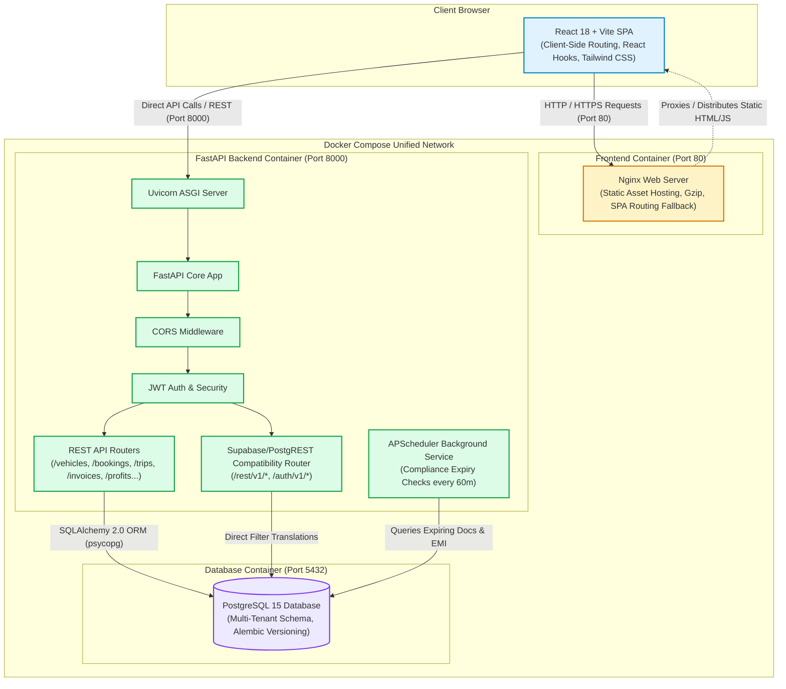

# 1. System Architecture

## Overview
VahanOne is structured as a decoupled three-tier multi-tenant web platform containerized with Docker and Docker Compose. It separates client-side SPA rendering, RESTful business logic and scheduling, and relational data storage.

## Architectural Highlights
1. **Containerized Network**: In local development and Docker Compose, services communicate over an internal bridge network (`db:5432` and `backend:8000`), with only ports 80 (Frontend) and 8000 (Backend) exposed to the host machine.
2. **Reverse Proxying**: In production Docker, Nginx acts as an HTTP server serving built SPA assets and redirecting all unhandled paths to `/index.html` to support HTML5 client-side history routing.
3. **Dual API Handling**: FastAPI handles native structured CRUD routers with Pydantic validation while concurrently serving a PostgREST-compatible translation engine (`/rest/v1/*`) to support client-side data querying without cloud dependencies.
