# 3. Authentication & Multi-Tenancy Flow

## Overview
VahanOne implements a **shared-database, pooled-schema multi-tenant architecture**. Each tenant is represented as an `Organization`. Every business entity (vehicles, drivers, bookings, invoices) contains an `organization_id` foreign key. Tenant isolation is enforced at the application layer via JWT claims and database indexes, supplemented by PostgreSQL Row-Level Security (RLS) where applicable.

```mermaid
flowchart TD
    subgraph Onboarding["1. Organization Onboarding (/auth/organizations/register)"]
        ReqOrg["POST Registration Data<br/>{org_name, admin_email, password}"] --> HashPwd["Hash Password<br/>(Passlib PBKDF2/Bcrypt)"]
        HashPwd --> CreateOrg["Insert into organizations<br/>(Generate UUID)"]
        CreateOrg --> CreateRoles["Create 'admin' & 'member' roles<br/>Assign default permissions"]
        CreateRoles --> CreateAdmin["Insert into users & user_roles<br/>Link to Organization UUID"]
        CreateAdmin --> CreateProfile["Insert into user_profiles<br/>(Display name & contact)"]
    end

    subgraph Authentication["2. Authentication Flow (/auth/login)"]
        LoginReq["POST /auth/login<br/>{email, password, optional org_id}"] --> VerifyCreds["Verify Hashed Password<br/>& Check is_active == true"]
        VerifyCreds --> GenTokens["Generate JWT Token Pair"]
        GenTokens --> AccessTok["Access Token (15-60 min)<br/>Claims: {sub: user_id, org_id: UUID, roles: [admin]}"]
        GenTokens --> RefreshTok["Refresh Token (30 days)<br/>Claims: {sub: user_id, version: 0, org_id: UUID}"]
        AccessTok & RefreshTok --> AuthResp["Return Auth Tokens to Client<br/>Stored in localStorage"]
    end

    subgraph RequestCycle["3. Multi-Tenant Request Isolation"]
        Req["API Request: GET /vehicles/<br/>Headers: Authorization: Bearer <token>"] --> ValToken["validate_token()<br/>Verify signature (HS256) & expiry"]
        ValToken --> ExtractClaims["Extract sub (user_id) & org_id"]
        ExtractClaims --> QueryUser["Verify user is active in DB<br/>Verify user.organization_id == token.org_id"]
        QueryUser --> RBAC["require_roles('admin', 'member')<br/>Verify role permissions"]
        RBAC --> ScopedQuery["SQLAlchemy Tenant Filtered Query:<br/>SELECT * FROM vehicles<br/>WHERE organization_id = :token_org_id<br/>AND deleted_at IS NULL"]
        ScopedQuery --> TenantData["Return strictly isolated tenant data"]
    end

    classDef onboard fill:#e0f2fe,stroke:#0284c7,stroke-width:2px;
    classDef auth fill:#fef3c7,stroke:#d97706,stroke-width:2px;
    classDef req fill:#dcfce7,stroke:#16a34a,stroke-width:2px;

    class ReqOrg,HashPwd,CreateOrg,CreateRoles,CreateAdmin,CreateProfile onboard;
    class LoginReq,VerifyCreds,GenTokens,AccessTok,RefreshTok,AuthResp auth;
    class Req,ValToken,ExtractClaims,QueryUser,RBAC,ScopedQuery,TenantData req;
```

## Security Invariants
1. **Zero Trust Client Identity**: The frontend cannot alter its tenant context. Every mutation relies strictly on `current_user.organization_id` derived cryptographically from the signed JWT access token.
2. **Compound Unique Constraints**: Uniqueness is scoped per tenant, not globally. For example:
   - `UniqueConstraint('organization_id', 'vehicle_number', name='uq_vehicle_org_number')`
   - `UniqueConstraint('organization_id', 'phone_number', name='uq_customer_org_phone')`
   This allows different transport companies to register standard local vehicle plates without collision.
3. **Token Invalidation**: Refresh tokens include a `refresh_token_version` integer column on the user table. Changing this integer immediately invalidates all active sessions for that user.
