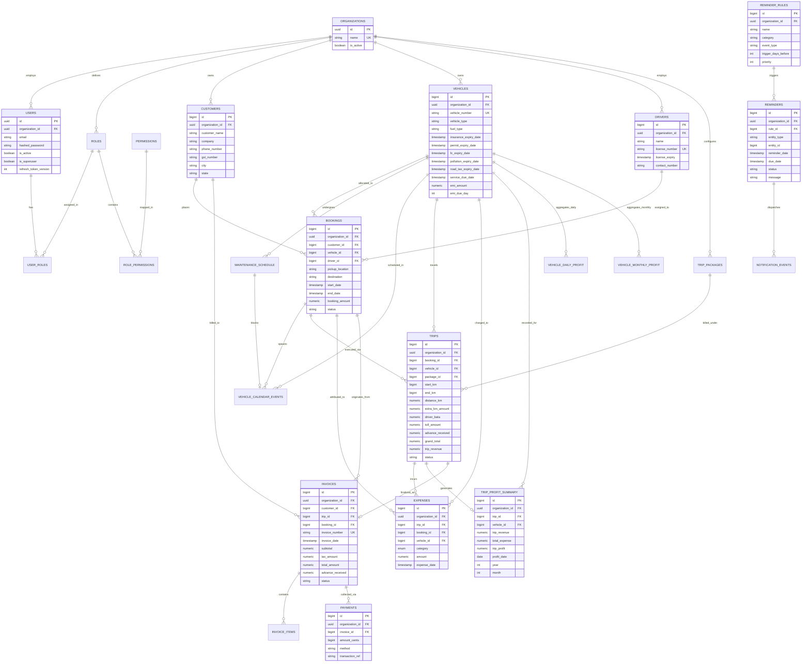

# 4. Database Entity-Relationship (ER) Diagram

## Overview
VahanOne operates on a normalized PostgreSQL schema with 27 relational tables. Core entities derive from three architectural base mixins:
- `TimestampMixin`: `created_at`, `updated_at` (automatic UTC timestamps)
- `TenantMixin`: `organization_id` (UUID foreign reference isolating every record)
- `SoftDeleteMixin`: `deleted_at` (preserving audit history on customers, vehicles, drivers)

## Key Schema Design Decisions
1. **Financial Integrity**: Money amounts in Invoices, Trips, and Expenses use `Numeric(12, 2)` for precision, while Payment transactions use `BigInteger amount_cents` to eliminate floating-point rounding errors.
2. **Double Linkage (Bookings & Trips)**: An Invoice links to both `customer_id` and optional `trip_id` / `booking_id`. This allows invoicing ad-hoc direct bookings as well as multi-leg trip contracts.
3. **Soft Deletions**: Deleting a vehicle or driver preserves historical booking and trip revenue calculations via `deleted_at IS NULL` query filters.
