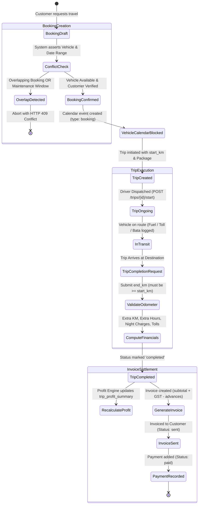
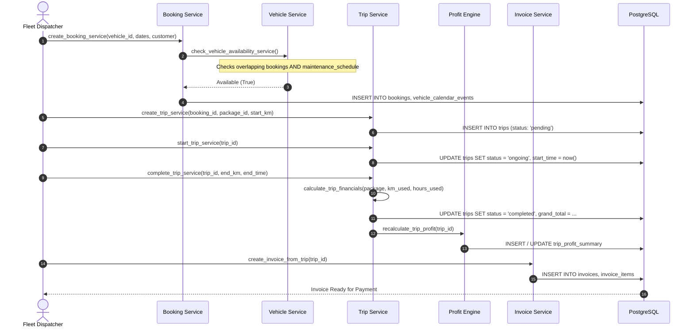

# 5. Booking Lifecycle Flow

## Overview
The VahanOne booking lifecycle orchestrates customer reservations from creation through vehicle conflict checking, dispatch, odometer execution, financial calculation, and invoice generation.

## Detailed Lifecycle Sequence

## Edge Cases Handled in Code
1. **Odometer Rollback Prevention**: `end_km` must be strictly `>= start_km`, else returns `HTTP 400 Bad Request`.
2. **Duplicate Active Trip Prevention**: `_assert_no_active_trip_for_booking` prevents dispatching multiple concurrent trips for the same booking.
3. **Double Maintenance Check**: A vehicle under scheduled maintenance cannot be booked, and maintenance cannot be scheduled over an active confirmed booking.
