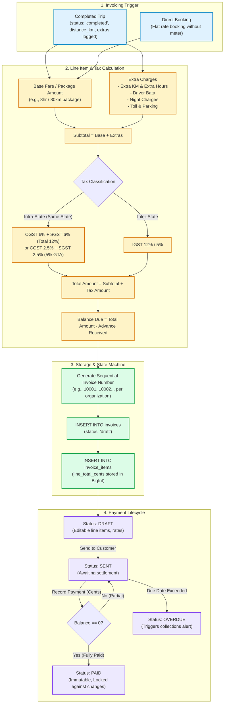

# 6. Invoice & GST Flow

## Overview
VahanOne provides an automated invoicing and tax calculation engine tailored to Indian transport logistics. It transforms completed trips into GST-compliant invoices with line items, deductions for advance payments, and payment state machines.

## Mathematical Formulae

$$\text{Subtotal} = \text{Package Amount} + (\text{Extra KM} \times \text{Rate}) + (\text{Extra Hours} \times \text{Rate}) + \text{Driver Bata} + \text{Toll} + \text{Night Charges}$$

$$\text{Total Invoice Amount} = \text{Subtotal} + \text{Tax Amount}$$

$$\text{Balance Due} = \text{Total Invoice Amount} - \text{Advance Received}$$

## Security & Concurrency Highlights
1. **Invoice Number Gap Prevention**: Sequential generation queries existing non-deleted numbers for the organization, finding the lowest available sequential index starting from `10001`.
2. **Double-Invoicing Guard**: A Unique Constraint on `(organization_id, trip_id)` and an explicit application check prevent multiple invoices against the same trip.
3. **Immutability of Settled Invoices**: Once status transitions to `PAID`, all `PUT /invoices/{id}` updates are blocked with `HTTP 400 Bad Request`.
