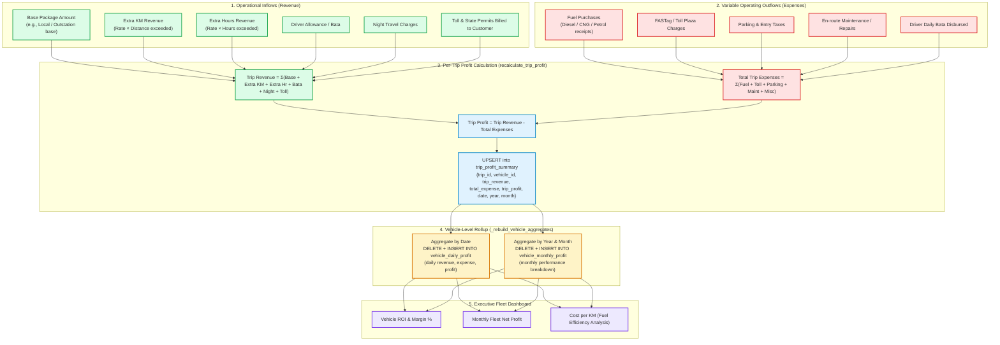

# 7. Profit Engine Flow

## Overview
The VahanOne Profit Engine bridges operational logistics with financial viability. It computes granular profitability across two orthogonal dimensions:
1. **Per-Trip Level**: Comparing realized trip billing against direct variable operating costs (fuel, tolls, driver bata, parking).
2. **Per-Vehicle Level**: Aggregating daily and monthly profit timelines to help fleet owners identify underperforming or high-maintenance vehicles.

## Calculation Formulas

$$\text{Trip Revenue} = \text{Package Amount} + (\text{Extra KM} \times R_{\text{km}}) + (\text{Extra Hours} \times R_{\text{hr}}) + \text{Bata} + \text{Night} + \text{Toll}$$

$$\text{Total Expenses} = \sum \text{Fuel} + \sum \text{Toll} + \sum \text{Parking} + \sum \text{Maintenance} + \sum \text{Misc}$$

$$\text{Net Profit}_{\text{Trip}} = \text{Trip Revenue} - \text{Total Expenses}$$

$$\text{Monthly Vehicle Profit} = \sum_{i=1}^{N_{\text{trips}}} \text{Trip Profit}_i$$

## Performance & Optimization Notes
- **Instant Recalculation**: Every time a new expense is logged (`POST /expenses/`) or a trip is completed (`POST /trips/{id}/complete`), `profit_service.recalculate_trip_profit` runs synchronously within the transaction.
- **Aggregated Projections**: The system caches daily and monthly totals in `vehicle_daily_profit` and `vehicle_monthly_profit` tables. This guarantees $O(1)$ response times for the front-end monthly charts without scanning millions of individual trip records.
