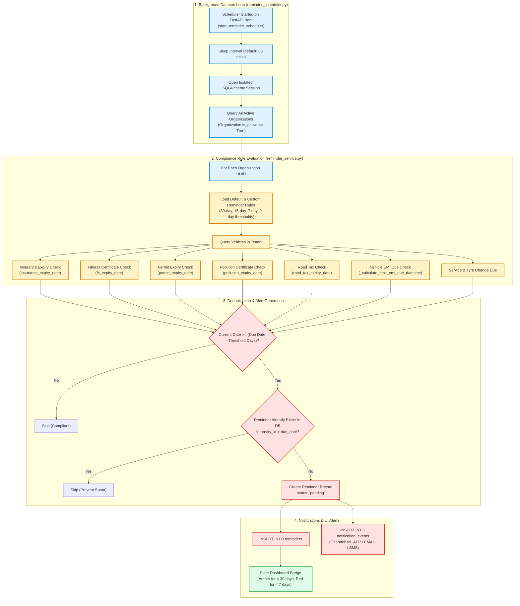

# 8. Compliance Reminder Scheduler

## Overview
VahanOne features an automated compliance and document expiry monitoring engine. It protects transport operators against heavy regulatory fines and vehicle impoundment under the Indian Motor Vehicles Act by tracking statutory renewals (RC, FC, Insurance, National Permits, PUC, Road Tax, EMI).

> [!NOTE]
> **Code vs. README Discrepancy**: While the original README mentions `APScheduler`, the production codebase executes a dedicated Python background daemon thread (`backend/app/services/reminder_scheduler.py`) using `threading.Thread` with a configurable sleep interval (`settings.reminder_scheduler_interval_minutes = 60`), guaranteeing lightweight execution without external broker dependencies.



## Compliance Threshold Matrix
| Statutory Document | Standard Indian Validity | System Warning Thresholds | Risk if Unaddressed |
| :--- | :--- | :--- | :--- |
| **Vehicle Insurance** | 1 Year (Comprehensive/Third-party) | **30 days, 15 days, 7 days** | Vehicle impounded; claims denied |
| **Fitness Certificate (FC)** | 1–2 Years (Commercial Vehicles) | **30 days, 15 days, 7 days** | Seizure of registration certificate |
| **State / National Permit** | 1–5 Years | **30 days, 15 days, 7 days** | Heavy inter-state border penalties |
| **Pollution (PUC)** | 6 Months | **15 days, 7 days, 1 day** | ₹10,000 fine under amended MV Act |
| **Road Tax** | Quarterly / Annual | **30 days, 15 days, 7 days** | Compound penalty interest |
| **Vehicle Loan EMI** | Monthly | **7 days, 3 days, Due Date** | Credit rating penalty; repossession risk |

## Deduplication Strategy
To avoid bombarding fleet managers with duplicate notifications every 60 minutes, the query explicitly checks:
```python
existing = reminder_repository.find_existing_reminder(
    db,
    organization_id=org_id,
    rule_id=rule.id,
    entity_type="vehicle",
    entity_id=vehicle.id,
    due_date=due_date
)
```
If an active or acknowledged reminder already exists for that specific due date, the scheduler idempotently skips creating another.
