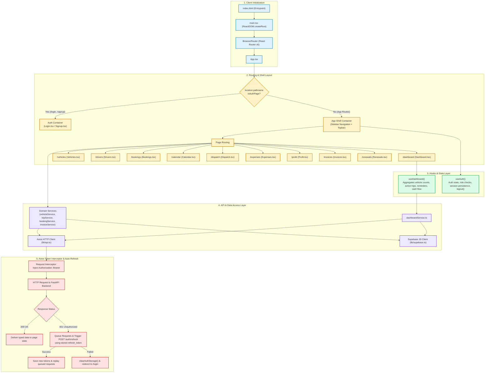

# 9. Frontend Architecture & Flow

## Overview
The VahanOne user interface is built as a single-page application (SPA) with **React 18**, **Vite**, **TypeScript**, and **Tailwind CSS**. It emphasizes responsive, low-latency fleet operations, optimistic client updates, token refresh management, and defensive error boundaries.

## State Management & Invariants
1. **No External Redux Overhead**: Local and custom hook state (`useState`, `useEffect`, `useCallback`) is used to keep bundle size small and render times instantaneous.
2. **Silent Refresh Interceptor**: `lib/api.ts` implements a subscriber queue (`subscribeTokenRefresh` and `onRefreshed`). If multiple parallel requests fail with `401`, only a single `POST /auth/refresh` is dispatched; upon resolution, all waiting requests retry seamlessly without user disruption.
3. **Dual Protocol Compatibility**: Frontend can communicate directly with FastAPI REST endpoints (`/bookings`, `/trips`) as well as the Supabase compatibility endpoints (`/rest/v1/*`), allowing seamless interoperability regardless of deployment target.
