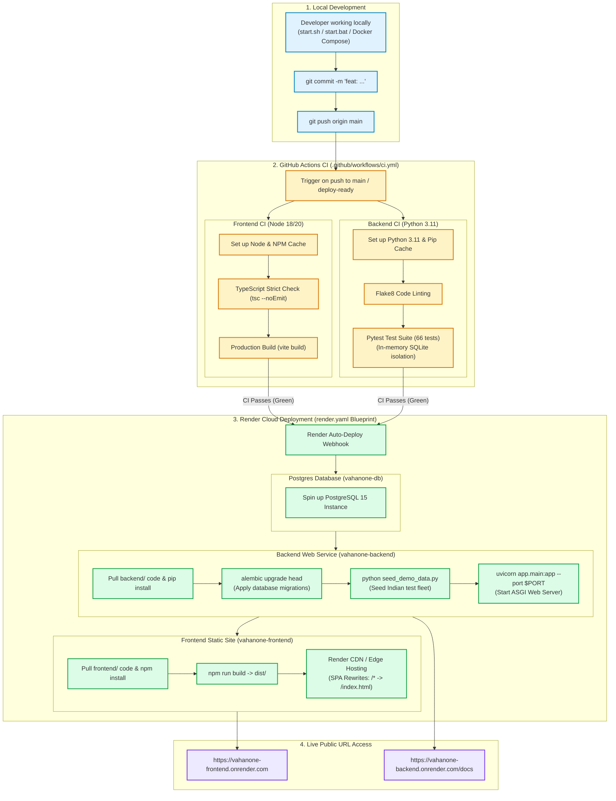

# 10. CI/CD & Deployment Pipeline

## Overview
The VahanOne deployment lifecycle ensures that every commit pushed to GitHub is automatically linted, type-checked, tested, built, containerized, and deployed to production cloud infrastructure with zero downtime.

## Production Pipeline Stages
1. **Linting & Hygiene**: `flake8` enforces PEP8 formatting rules and catches undefined symbols and circular imports before any deployment begins.
2. **Type Safety Verification**: `tsc --noEmit` verifies strict TypeScript typing across all components, interfaces, and API responses.
3. **Database Migration Synchronization**: Database schema changes are version-controlled via Alembic revisions (`alembic/versions/`). During container boot or Render deployment, `alembic upgrade head` runs automatically before the web server begins accepting HTTP traffic.
4. **Zero-Downtime Deployment**: Render creates the new container instances, waits for HTTP `GET /` to return `200 OK`, and then swaps the DNS router to the new container without dropping in-flight client requests.
