# 11. Fleet Owner Day-to-Day User Journey

## Overview
This journey maps a typical day in the life of a commercial fleet owner or logistics operator (e.g., managing 10 to 50 passenger buses or commercial trucks in India) using VahanOne to drive operational efficiency and financial clarity.

```mermaid
journey
    title A Day in the Life of a Fleet Owner using VahanOne
    section 08:00 AM - Morning Compliance & Status
      Open Dashboard & review fleet availability: 5: Fleet Owner
      Inspect amber/red compliance alerts (Insurance, FC, EMI): 4: Fleet Owner
      Acknowledge driver duty schedules: 5: Fleet Owner
    section 10:00 AM - Bookings & Dispatch
      Receive corporate customer travel request: 5: Fleet Owner
      Create new Booking in VahanOne: 5: Fleet Owner
      System verifies vehicle conflict & calendar: 5: System
      Assign Driver & Vehicle; mark Confirmed: 5: Fleet Owner
    section 01:00 PM - Trip Execution & Expense Tracking
      Driver arrives at pickup; start trip: 4: Driver
      Log starting odometer reading (start_km): 4: Fleet Owner
      Driver logs en-route diesel and toll plaza expenses: 4: Driver
      Monitor active trips on live Dispatch board: 5: Fleet Owner
    section 06:00 PM - Trip Settlement & Invoicing
      Trip completed at destination; submit end_km: 5: Fleet Owner
      System computes distance, extra KM, and driver bata: 5: System
      Generate GST-compliant tax invoice: 5: Fleet Owner
      WhatsApp/Email PDF invoice link to corporate client: 5: Fleet Owner
    section 08:00 PM - Executive Profit & Review
      Open Profit Engine dashboard: 5: Fleet Owner
      Inspect Net Profit (Revenue - Fuel - Toll - Bata): 5: Fleet Owner
      Review monthly profit trends per vehicle: 5: Fleet Owner
      Identify top-earning vehicles & high-maintenance assets: 5: Fleet Owner
```

## Detailed Workflow Diagram

```mermaid
flowchart TD
    subgraph Morning["08:00 AM — Operations & Compliance Check"]
        Login["1. Log into VahanOne Dashboard"] --> ReviewAlerts["2. Check Compliance Expiry Badges<br/>(Insurance, FC, Road Tax, EMI)"]
        ReviewAlerts --> ReviewFleet["3. Inspect Vehicle Calendar<br/>(See vehicles in transit vs available)"]
    end

    subgraph Midday["10:00 AM — Booking & Conflict Checking"]
        ReviewFleet --> NewBooking["4. Create Booking (/bookings)<br/>Pickup, Destination, Dates, Rates"]
        NewBooking --> SysConflict["5. System Conflict Engine<br/>Validates no overlapping trips or maintenance"]
        SysConflict --> ConfirmDispatch["6. Assign Driver & Vehicle<br/>Calendar blocks time automatically"]
    end

    subgraph Afternoon["01:00 PM — Execution & Expense Logging"]
        ConfirmDispatch --> TripStart["7. Start Trip (/trips/{id}/start)<br/>Record Start Odometer"]
        TripStart --> LogExpense["8. Log En-route Expenses (/expenses)<br/>Diesel fuel receipts, Toll FASTag, Parking"]
    end

    subgraph Evening["06:00 PM — Settlement & Invoicing"]
        LogExpense --> CompleteTrip["9. Complete Trip (/trips/{id}/complete)<br/>Input End Odometer reading"]
        CompleteTrip --> CalcBill["10. System Financial Calculations<br/>Total Distance, Extra KM, Night Charges"]
        CalcBill --> IssueInvoice["11. Generate Invoice (/invoices)<br/>Add 12% GST, deduct advances, send to client"]
    end

    subgraph Night["08:00 PM — Profit Analysis"]
        IssueInvoice --> ViewProfit["12. Open Profit Dashboard (/profit)<br/>Inspect Vehicle Net Profit = Revenue - All Expenses"]
        ViewProfit --> Optimize["13. Optimize Fleet Maintenance & Planning"]
    end

    classDef morning fill:#e0f2fe,stroke:#0284c7,stroke-width:2px;
    classDef midday fill:#fef3c7,stroke:#d97706,stroke-width:2px;
    classDef afternoon fill:#dcfce7,stroke:#16a34a,stroke-width:2px;
    classDef evening fill:#ede9fe,stroke:#7c3aed,stroke-width:2px;
    classDef night fill:#fee2e2,stroke:#dc2626,stroke-width:2px;

    class Login,ReviewAlerts,ReviewFleet morning;
    class NewBooking,SysConflict,ConfirmDispatch midday;
    class TripStart,LogExpense afternoon;
    class CompleteTrip,CalcBill,IssueInvoice evening;
    class ViewProfit,Optimize night;
```



## Core Value Proposition Delivered to User
1. **Zero Fine Exposure**: Compliance warnings 30 days ahead prevent sudden vehicle impoundment and police fines.
2. **Elimination of Double-Bookings**: Automatic vehicle calendar conflict checks eliminate customer booking overlapping errors.
3. **True Vehicle ROI Clarity**: Replaces fragmented WhatsApp slips and paper logbooks with exact rupee-for-rupee profitability per vehicle.
